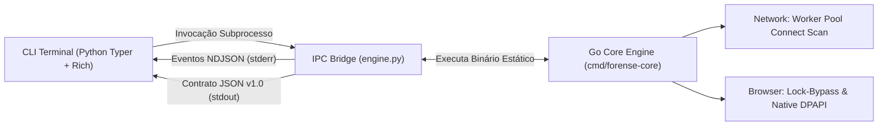

# ForenseLab (`forensic-cli`)

[](https://pypi.org/project/forensic-cli/)
[](https://www.python.org/)
[](https://golang.org/)
[](LICENSE)
[](#instalação)

> **Toolkit Forense Digital e Resposta a Incidentes (DFIR) de Alta Performance.**  
> Combina uma interface de linha de comando ergonômica em Python (`Typer` + `Rich`) com um motor de execução ultrarrápido compilado em Go puro (`Zero CGO`), comunicando-se via IPC streaming (`NDJSON`).

---

## ⚠️ Aviso Legal e Ético (Disclaimer)

> [!CAUTION]
> **ESTA FERRAMENTA FOI CRIADA EXCLUSIVAMENTE PARA FINS EDUCACIONAIS, DE PESQUISA ACADÊMICA (ORIGINADA COMO PROJETO DE TCC) E PARA USO EM PERÍCIAS FORENSES E AUDITORIAS DE SEGURANÇA DEVIDAMENTE AUTORIZADAS.**
> 
> A extração de dados e a realização de varreduras em sistemas ou redes sem autorização expressa e por escrito do proprietário dos ativos constitui conduta ilegal e passível de sanções civis e criminais de acordo com as leis vigentes (ex.: Lei nº 12.737/2012 e Lei Geral de Proteção de Dados - LGPD no Brasil). Os autores e mantenedores deste projeto não se responsabilizam por quaisquer danos decorrentes do uso inadequado desta ferramenta.

---

## 🏗️ A Nova Arquitetura Híbrida: Por que Python + Go?

O **ForenseLab v2.0** resolve um dilema clássico no desenvolvimento de ferramentas forenses:
* O **Python** oferece ecossistema incomparável para formatação visual no terminal (`Rich`), parsing estruturado de dados, geração de laudos em HTML (`Jinja2`) e facilidade de extensão.
* O **Go** fornece alta performance concorrente, controle estrito de alocação de memória, compilação estática sem runtime pesado e acesso direto e desimpedido a APIs de baixo nível do Sistema Operacional.

Em vez de sacrificar a experiência do usuário (UX) ou a velocidade, o ForenseLab adota o padrão **CLI Wrapper Híbrido**:



### Principais Benefícios da v2.0:
1. **Network Scanner com Concorrência Real:** Port Scanner e Ping Sweep orquestrados por Worker Pools em Goroutines (`net.DialTimeout`), sem travar o interpretador com a GIL do Python e sem estourar File Descriptors.
2. **Zero Privilégios (No Admin/Npcap):** Eliminação do `scapy`. Não requer instalação de drivers externos (como Npcap ou WinPcap) nem privilégios de root/administrador para varreduras TCP locais e remotas.
3. **Contorno de Travamento de Banco (Lock-Bypass no Windows):** Navegadores como Chrome e Edge mantêm locks exclusivos em arquivos SQLite. O motor Go usa a API Win32 `windows.CreateFile` com `FILE_SHARE_READ | FILE_SHARE_WRITE | FILE_SHARE_DELETE` para copiar o banco principal, arquivos `-wal` e `-shm` em tempo de execução sem corrupção.
4. **Cripto Forense com DPAPI Nativo:** Descriptografa a Master Key do Chromium diretamente pela chamada de sistema `CryptUnprotectData` (da `crypt32.dll`), eliminando dependências externas como `pywin32` e `cryptography`.
5. **Streaming com O(1) de Memória:** O motor Go transmite resultados linha a linha via **NDJSON**, permitindo iterar sobre centenas de milhares de registros sem esgotar a RAM do examinador.

---

## 📦 Instalação (Para Usuários Finais)

O usuário final **NÃO** precisa ter a linguagem Go instalada na máquina. 

O pacote distribuído no PyPI utiliza **Platform-Specific Wheels**: durante o processo de build no CI/CD, o executável compilado do Go é injetado diretamente dentro da pasta `src/bin/` da wheel do seu respectivo Sistema Operacional.

```bash
pip install forensic-cli
```

### Plataformas Suportadas Nativamente:
* **Windows** (x86_64 / amd64)
* **Linux** (x86_64 / manylinux2014)
* **macOS** (Apple Silicon `arm64` e Intel `x86_64`)

Para verificar a instalação:
```bash
forensic-cli --help
```

---

## 🚀 Exemplos de Uso

### 1. Port Scan TCP Concorrente
Escaneie portas estratégicas em alta velocidade com barra de progresso em tempo real e saída tabular formatada:
```bash
forensic-cli network scan --target 192.168.1.1 --ports 21,22,80,443,445,3389,8080 --workers 500
```

### 2. Ping Sweep e Descoberta de Hosts Ativos
Varredura rápida em bloco CIDR ou range de IPs sem necessidade de privilégios de root:
```bash
forensic-cli network sweep --network 192.168.1.0/24
```

### 3. Extração Forense de Logins com Laudo Pericial HTML
Recupere credenciais salvas do Chrome e Edge (mesmo abertos) e gere laudo técnico com cálculo automático do hash SHA-256 da evidência:
```bash
forensic-cli browser logins --all --export-html laudo_logins.html
```

### 4. Mapeamento Topológico Visual da Rede
Gera um grafo interativo em HTML usando `pyvis` a partir do sweep do Go Core:
```bash
forensic-cli network map --network 192.168.1.0/24
```

---

## 🛠️ Guia para Desenvolvedores (Contributing)

Se você é estudante, perito ou pesquisador de segurança e deseja contribuir ou executar o projeto localmente:

### 1. Clonando o Repositório
```bash
git clone https://github.com/ErickG123/devkit_forense.git
cd devkit_forense
```

### 2. Configurando o Ambiente Virtual com Reset Automático
Utilize o script de reset limpo de dependências:

* **No Windows (PowerShell):**
  ```powershell
  .\reset_env.ps1
  ```
* **No Linux / macOS (Bash):**
  ```bash
  chmod +x reset_env.sh
  ./reset_env.sh
  ```
* **Ou via Makefile:**
  ```bash
  make reset-env
  ```

### 3. Modo JIT (Just-In-Time) com `FORENSE_DEV=1`
Para desenvolver e testar alterações no código Go **sem precisar recompilar o binário a cada alteração**:
```bash
# Linux/macOS
export FORENSE_DEV=1

# Windows (PowerShell)
$env:FORENSE_DEV="1"
```
Com essa variável ativa, o `src/shared/binary_resolver.py` executará o código Go sob demanda usando `go run ./cmd/forense-core`.

### 4. Compilação Manual do Binário Nativo
Para compilar o binário de produção otimizado com *stripping* de símbolos (`-s -w`):
```bash
make build-core
```

### 5. Execução da Suíte Completa de Testes
O projeto conta com suíte de testes unitários isolados em Go, testes com mocks no Python e testes de integração end-to-end:
```bash
# Executa toda a esteira de validação
make test

# Ou diretamente via pytest:
py -m pytest tests/ -v
```

---

## 📄 Licença

Este projeto é distribuído sob os termos da licença [MIT](LICENSE).
