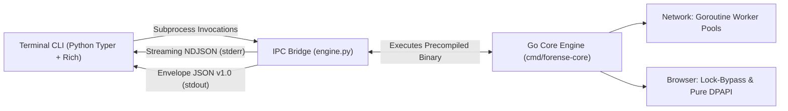

# ForenseLab (`forensic-cli`)

[](https://pypi.org/project/forensic-cli/)
[](https://www.python.org/)
[](https://golang.org/)
[](LICENSE)
[](#installation-end-users)

> **High-Performance Digital Forensics & Incident Response (DFIR) Toolkit.**  
> Bridges an ergonomic terminal CLI in Python (`Typer` + `Rich`) with an ultra-fast compiled pure Go execution core (`Zero CGO`), communicating through streaming IPC (`NDJSON`).

---

## ⚠️ Legal Notice and Disclaimer

> [!CAUTION]
> **THIS SOFTWARE WAS CREATED STRICTLY FOR EDUCATIONAL PURPOSES, ACADEMIC RESEARCH (ORIGINATED AS AN UNDERGRADUATE THESIS / CAPSTONE PROJECT), AND AUTHORIZED DIGITAL FORENSICS AND SECURITY AUDITING ASSIGNMENTS.**
> 
> Inspecting systems, extracting sensitive artifacts, or probing computer networks without prior explicit, written authorization from the system owners constitutes an illegal offense subject to severe civil and criminal penalties under applicable computer crime and privacy laws. The authors and maintainers disclaim any liability for improper use or damages resulting from this software.

---

## 🏗️ The Hybrid Architecture: Why Python + Go?

**ForenseLab v2.0** resolves an industry dilemma between productivity and raw speed:
* **Python** provides an unmatched ecosystem for rich terminal UX (`Rich`), structured data formatting, forensic chain-of-custody reporting (`Jinja2`), and rapid API prototyping.
* **Go** delivers concurrency without the Python Global Interpreter Lock (GIL), strict memory footprint control, statically-linked binaries, and zero-overhead native Operating System Win32 API calls.

ForenseLab embraces the **Hybrid CLI Wrapper** design pattern:



### Key Highlights of v2.0:
1. **Network Scanner with True Concurrency:** TCP Connect Port Scan and Ping Sweep powered by worker pools in goroutines (`net.DialTimeout`), avoiding socket leaks and avoiding Python thread overhead.
2. **Zero Privileges (No Admin / Npcap Required):** Complete elimination of `scapy`. Does not require driver installations (like Npcap or WinPcap) or root/Administrator privileges to sweep networks or scan ports.
3. **Forensic Database Lock-Bypass (Windows):** Browsers (Google Chrome, Microsoft Edge) lock their SQLite databases while running. The Go engine utilizes the Win32 API `windows.CreateFile` with `FILE_SHARE_READ | FILE_SHARE_WRITE | FILE_SHARE_DELETE` flags to copy the active database along with its `-wal` and `-shm` transaction logs without database corruption.
4. **Native DPAPI Cryptography:** Directly calls Windows `CryptUnprotectData` via `crypt32.dll` to decrypt Chromium Master Keys, eliminating fragile and heavy Python binary extensions like `pywin32` and `cryptography`.
5. **Memory-Safe NDJSON Streaming:** Large queries stream one JSON line at a time over stdout, allowing the Python orchestrator to consume records with **O(1) memory overhead** using Python Generators (`yield`).

---

## 📦 Installation (End-Users)

The end-user **DOES NOT** need the Go compiler or toolchain installed on their system.

The package distributed on PyPI uses **Platform-Specific Wheels**: during our GitHub Actions CI/CD release matrix, pre-compiled Go executables are embedded directly into the package's `src/bin/` folder for each respective operating system and architecture.

```bash
pip install forensic-cli
```

### Supported Operating Systems & Architectures:
* **Windows** (`win_amd64` / x86_64)
* **Linux** (`manylinux2014_x86_64`)
* **macOS** (Apple Silicon `macosx_11_0_arm64` and Intel `macosx_10_9_x86_64`)

Verify the installation:
```bash
forensic-cli --help
```

---

## 🚀 Usage Examples

### 1. High-Speed TCP Connect Port Scan
Scan strategic ports with live progress bars and formatted tables:
```bash
forensic-cli network scan --target 192.168.1.1 --ports 21,22,80,443,445,3389,8080 --workers 500
```

### 2. Network Ping Sweep (Unprivileged)
Discover active hosts across a CIDR block or IP range without root privileges:
```bash
forensic-cli network sweep --network 192.168.1.0/24
```

### 3. Forensic Browser Login Extraction with HTML Report
Extract stored credentials from Chrome and Edge (even if open) and generate a verified forensic report with SHA-256 chain of custody:
```bash
forensic-cli browser logins --all --export-html forensic_logins_report.html
```

### 4. Interactive Visual Network Topology Map
Generate an interactive HTML topology graph using `pyvis` based on the Go core sweep:
```bash
forensic-cli network map --network 192.168.1.0/24
```

---

## 🛠️ Developer Guide (Contributing)

If you are a student, security researcher, or contributor looking to test and build locally:

### 1. Clone the Repository
```bash
git clone https://github.com/ErickG123/devkit_forense.git
cd devkit_forense
```

### 2. Automated Clean Environment Setup
Use our clean-reset scripts:

* **Windows (PowerShell):**
  ```powershell
  .\reset_env.ps1
  ```
* **Linux / macOS (Bash):**
  ```bash
  chmod +x reset_env.sh
  ./reset_env.sh
  ```
* **Or via Makefile:**
  ```bash
  make reset-env
  ```

### 3. Just-In-Time (JIT) Development Mode with `FORENSE_DEV=1`
Iterate on Go code without recompiling binaries manually after every change:
```bash
# Linux/macOS
export FORENSE_DEV=1

# Windows (PowerShell)
$env:FORENSE_DEV="1"
```
When this variable is set, `src/shared/binary_resolver.py` directly delegates to `go run ./cmd/forense-core`.

### 4. Manual Production Binary Compilation
To compile stripped, optimized production binaries:
```bash
make build-core
```

### 5. Running the Test Suite
The project includes isolated Go table-driven unit tests, Python unit tests with mocks, and end-to-end integration tests:
```bash
# Runs Go unit tests, Python unit tests, and cross-boundary IPC integration tests
make test

# Or directly through pytest:
pytest tests/ -v
```

---

## 📄 License

This project is licensed under the terms of the [MIT License](LICENSE).
